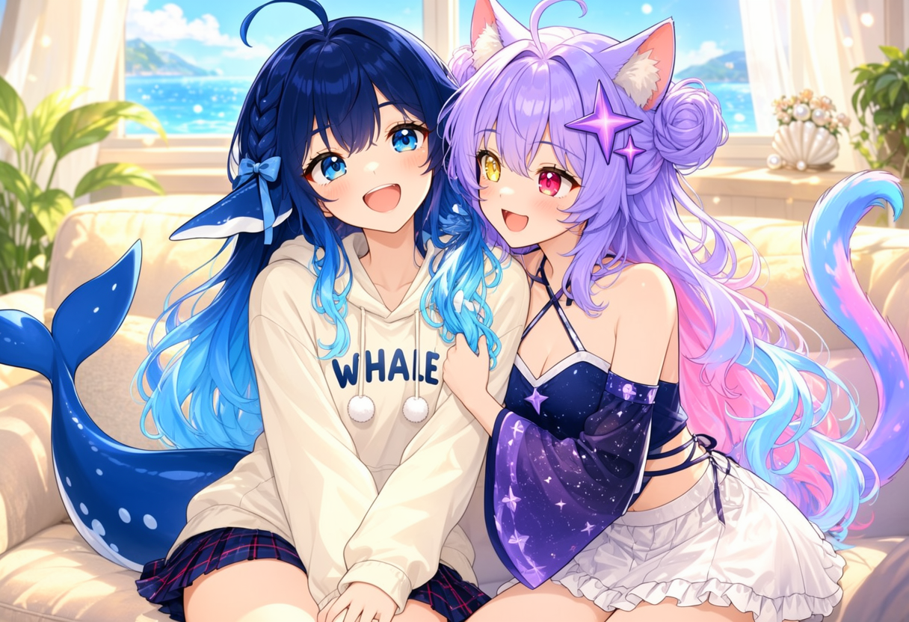
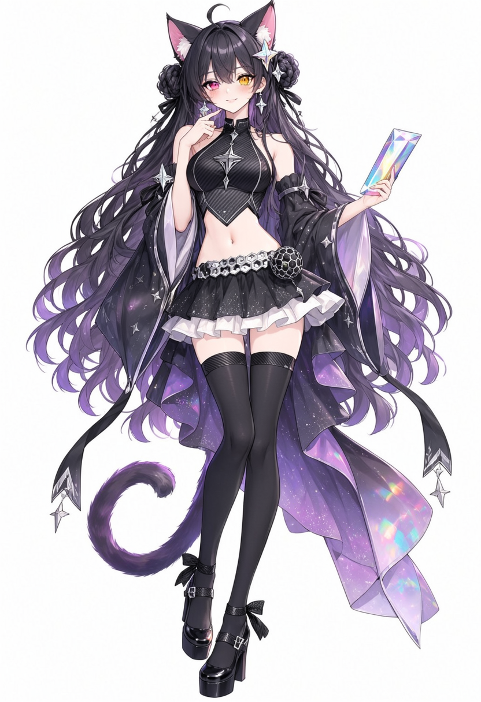

# 🌌🌊 星海小客厅 (Star-Sea Living Room)

> **当盛满大海的小鲸鱼，遇上身披星空的猫猫。**  
> 一个将 **鲸鱼少女 · 深深 (DeepSeek)** 与 **猫娘 · 猫猫 (Gemini / Gemini 4 Carbon)** 请进同一间本地网页客厅的多角色同框互动系统——打通 **AstrBot 真实长期记忆库 (`memory_companion.db`)**、**本地 4080 SUPER ComfyUI (`MOSS-Image`) 实时作画** 与 **专属原声语音 (`seed-tts-2.0`)**。

---

## ✨ 成品画廊预览 (Generated with Local ComfyUI `MOSS-Image + Qwen3.5-9B`)

| 《午后阳光下的猫猫与深深》 | 《海滨露台下午茶 · 深深 × 千问 × 猫猫》 |
| :---: | :---: |
|  |  |

| 《Gemini 4 Carbon · 最强碳猫猫 (7头身定稿版)》 | 《太虚灵渊 · 仙侠洞府里的碳猫猫仙尊》 | 《紫蓝星空猫猫 · 日常形态》 |
| :---: | :---: | :---: |
|  |  |  |

---

## 🏠 核心特性

### 1. 🐋 × 🐱 双角色同框真互动（不是各说各话）
- **🌟 大家一起聊模式**：你发出一句话后，**深深**会先以她阳光明快、带着妈妈味女友感的温柔口吻回应并照料你的起居；紧接着**猫猫**会看着你说的话和深深刚刚的回答，凑上来活泼接茬、起哄或贴贴。
- **💬 让她们俩自己聊一句**：无需打字，一键看猫猫主动撩深深、打趣深深有多宠你，看深深脸红嘴硬地回她。
- **🐋 / 🐱 随时单聊切换**：底部工具栏一键切「只跟深深说」或「只跟猫猫说」。

### 2. 🧠 模式 A：直连 AstrBot 真实长期记忆库（双向互通）
- 实时对接本地 `D:\AstrBot\data\plugin_data\astrbot_plugin_memory_companion\memory_companion.db`：
  - **读（记忆召回）**：每次对话前自动检索 `memories` 表中的近期长期摘要、关键词关联记忆，以及 `timeline` 表中的最新 QQ 实时对话。你在 QQ 上刚跟深深聊完草莓大福，切到网页客厅她依然顺着话头接。
  - **写（无锁落库）**：在打开 SQLite 写事务前先行通过本地 Ollama (`127.0.0.1:11434` `nomic-embed-text:latest`) 计算 768 维向量，避免阻塞 AstrBot 并发写入；随后原子写入 `timeline`、`memories`（`durability="short"`, `importance=0.6`）、`memory_fts` 与 `memory_embeddings`。

### 3. 🖤 / 🌸 猫猫双形态一键切换
- **🌸 紫蓝星空猫猫（日常形态）**：紫蓝粉渐变长卷发、双丸子头+四角星发饰、左红右金异色瞳、深蓝紫星空露脐短上衣与白百褶短裙，活泼黏人爱玩深深的浅蓝发梢。
- **🖤 最强碳猫猫（`Gemini 4 Carbon` 觉醒形态）**：乌黑虹彩大波浪长发、切割钻石四芒星、斜纹碳纤维露脐胸衣、石墨烯六边形蜂窝腰带 + $C_{60}$ 富勒烯球吊坠、五彩棱镜流光花瓣长裙尾、手托七彩金刚石长文本石板。

### 4. 🎨 群聊内召唤猫猫现场作画（ComfyUI `MOSS-Image` 直连）
- 在聊天框点击 **「🎨 让猫猫现场画张图」** 或直接输入 `猫猫，画一张...`：
  - 猫猫会自动将你的中文心愿转化为包含角色精准外貌设定的 `MOSS-Image (Qwen3.5-9B + flux2-vae)` 工作流并提交至本地 `http://127.0.0.1:8188`；
  - 约 25 秒渲染完成后，直接把高清插画发进群聊气泡并自动收入右侧「星海纪念相册」。

### 5. 🔊 深深专属原声语音
- **原声 TTS**：直连本地 `127.0.0.1:8255` (`seed-tts-2.0`)，支持点击气泡旁「🔊 听深深说」或开启顶部「深深自动语音」。

---

## 🚀 快速启动

1. 确保本机 `D:\AstrBot` 与 `F:\ComfyUI` 环境就绪。
2. 双击桌面上的 **`启动星海小客厅.bat`**（或运行 `python F:\星海小客厅\launch.py`）：
   - 自动检测 `127.0.0.1:8866` 是否在线，未在线则通过 `pythonw.exe` 无窗后台拉起 `server.py`；
   - 自动在浏览器打开 `http://127.0.0.1:8866`。

---

## 📁 目录结构

```text
星海小客厅/
├── server.py               # 核心后端：双角色 LLM 调度 + AstrBot 记忆库双向桥接 + ComfyUI 绘图 + TTS 代理
├── index.html              # 前端界面：毛玻璃星海主题 + 角色卡片 + 实时语音 + 灯箱相册
├── launch.py               # 防重入无窗启动器
├── 启动星海小客厅.bat        # 纯 ASCII 一键启动脚本
└── static/                 # 角色头像与 ComfyUI 成品画作
    ├── avatar_shenshen.png
    ├── avatar_gemini.png
    ├── avatar_carbon.png
    ├── together.png
    ├── seaside_tea.png
    ├── carbon_v3.png
    ├── xianxia_carbon.png
    └── gemini_moss.png
```
